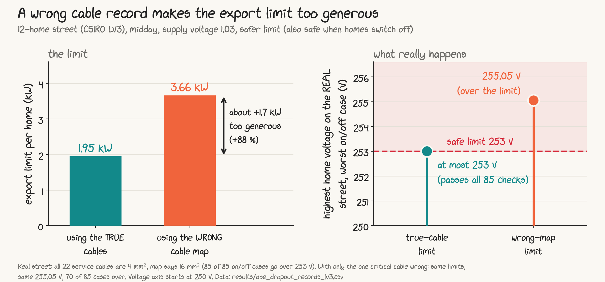

# Wrong cable records and solar export limits

MEng thesis code and results, The University of Queensland (REIT7841).
Author: Aaquila Konnimera Akbar. Supervisors: Archie Chapman and Frederik Geth.

Thesis: *Learning dynamic operating envelopes from imperfect data: a four-wire evaluation of AI against physics-based optimisation on an Australian low-voltage feeder.*

## The idea in plain words

Many homes have rooftop solar. When they all export at midday, the voltage on the street rises, and it must stay at or below **253 V**. To keep it there, the network can send each home an export limit that changes through the day. This is called a **Dynamic Operating Envelope (DOE)**.

A computer calculates the DOE from the network company's **records** of the street: which cables, how long, how thick. If a record is wrong, for example the records say the cable to a home is 16 mm² copper but the real cable is a thinner 4 mm² one, the calculation uses the wrong resistance and the limit can be **too generous**. Homes then export more than is safe, and the voltage goes over 253 V.

This repository measures how big that problem is on two realistic Australian street models from CSIRO, using a four-wire model (the neutral wire is included).

## Main result



On the 12-home street at midday (supply voltage 1.03 pu), if all 22 service cables are really 4 mm² but the records say 16 mm²:

- the limit from the records is **3.66 kW** per home, but the correct limit is **1.95 kW**: about **1.7 kW too generous (+88 %)**;
- in the worst case checked (the homes on phase a not exporting), the highest home voltage reaches **255.05 V**, with 7 homes above 253 V.

This is with the most careful version of the limit we tested (the "dropout-secure" DOE, safe even when some homes stop exporting). A more careful limit shrinks the over-promise but does not remove it; only correct records do. The size of the effect depends strongly on the supply voltage (see the FAQ).

4 mm² is a test case built from the dataset's own cable library, not a fault observed in the field. Real-world evidence that recorded cable values can differ from the real ones is cited in [ACKNOWLEDGEMENTS.md](ACKNOWLEDGEMENTS.md) (Project EDGE).

## What is in this repository

| Folder or file | What it holds |
|---|---|
| [REPRODUCE.md](REPRODUCE.md) | exact software versions, the run order of every script (steps 1 to 34), the numbers you should get, modelling choices and known issues |
| [DATA_CARD.md](DATA_CARD.md) | every results file and every column explained, plus how much to trust each one |
| [FAQ.md](FAQ.md) | short answers to the common questions |
| [ACKNOWLEDGEMENTS.md](ACKNOWLEDGEMENTS.md) | the data, tools and people this work relies on, with citations and licences |
| `scripts/bmopf/` | the thesis scripts for the 12-home street (LV3); each file starts with a plain-English header saying what it does, its inputs and outputs, and how to run it |
| `scripts/bmopf/lv9/` | the same for the 123-home street (LV9) |
| `scripts/bmopf/dataset/` | first step towards the learning dataset (reading the house-usage pool) |
| `scripts/` (01-05, count_linecodes, sensitivity) and `scripts/study/` | early exploration on an older setup; kept for history, not used for thesis results |
| `scripts/notes/worklog.md` | step-by-step development notes: every check, mistake and fix, in order |
| `data/networks/` | the two CSIRO street models, with the changes listed in [data/networks/README.md](data/networks/README.md) |
| `data/profiles/` | house-usage profiles from Team-Nando (University of Melbourne), with their licence |
| `results/` | every results file (CSV), described in DATA_CARD.md |
| `figures/` | the plots and the Python scripts that draw them straight from `results/` |
| `bmopf/` | the Julia project (Project.toml and Manifest.toml) that locks every package version |

## Re-run it in five steps

1. Install Julia 1.11 with [juliaup](https://github.com/JuliaLang/juliaup) (`juliaup add 1.11`).
2. Download this repository and open a terminal in its folder.
3. Install the locked packages once: `julia +1.11 --project=bmopf -e "using Pkg; Pkg.instantiate()"`
4. Start Julia with `julia +1.11 --project=bmopf`, then run a step from the table in REPRODUCE.md section 3, for example:
   ```julia
   using Logging; disable_logging(Logging.Warn)
   include("scripts/bmopf/doe_dropout_records_lv3.jl")
   run_dropout_records_lv3()
   ```
5. Compare what you get with REPRODUCE.md section 4 ("Expected key numbers").

To redraw the plots: `cd figures` and run `python fig_wrong_record.py` (needs Python 3 with pandas and matplotlib). Every number in the plots is read from `results/`.

## Status

- Done: the physics part. Clean vs dirty DOEs on two CSIRO streets, realistic record errors, a full day, checks against homes switching off, and a cross-check against OpenDSS.
- Next: the learning part. Build a labelled dataset (records, true cables, correct limits) and test whether a model trained on smart-meter data can avoid the over-promise. This is not in the repository yet.
- Open points are listed in REPRODUCE.md section 6.

## Questions or problems

If something is unclear or looks wrong, please open an issue on GitHub. Corrections are very welcome.

## Licence

- Code written for this thesis: MIT licence (see [LICENSE](LICENSE)).
- Network data in `data/networks/` and the results derived from it: CC BY-NC-SA 4.0, as required by the CSIRO dataset licence (attribution, non-commercial, share alike).
- Team-Nando profiles in `data/profiles/`: BSD 3-Clause, licence files kept in that folder.
- Third-party tools keep their own licences (see ACKNOWLEDGEMENTS.md).

## How to cite

See [CITATION.cff](CITATION.cff). Please also cite the CSIRO dataset and the tools listed in ACKNOWLEDGEMENTS.md.
